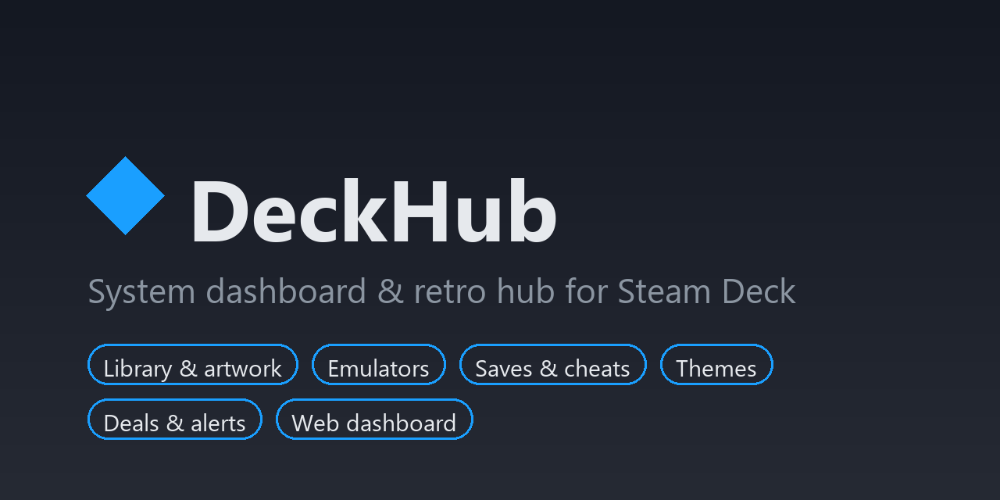

# DeckHub



**System dashboard and retro hub for the Steam Deck**, as a [Decky Loader](https://decky.xyz) plugin with a web dashboard you can open from your PC, your phone or the Deck itself.

> 🇪🇸 [Versión en español más abajo](#español)

- **Library**: Steam games and emulator ROMs in one place, with per-game details: playtime, ProtonDB, launch options, Proton version, hide, play.
- **Artwork**: pick covers, heroes and logos from SteamGridDB for any game.
- **Emulation**: install and configure PCSX2, Eden, RetroArch and more; add ROMs to Steam in one click; saves backup and cheats.
- **Customize**: Game Mode themes (via CSS Loader, installed for you), boot videos and wallpapers with recommended downloads.
- **Deals**: track your wishlist prices, historical lows and get notified on the Deck.
- **System**: microSD/USB mounting, file manager, Flatpak packages, "Download all" for pending Steam updates.
- **Multi-language**: follows your Steam language (English and Spanish included; [add yours](docs/translating.md)).

DeckHub never downloads games, BIOS, firmware or keys, and never buys anything or touches your Steam account.

## Install

You need **Decky Loader**. If you don't have it yet: switch to Desktop Mode, open [decky.xyz](https://decky.xyz) in the browser, download the installer and run it; then go back to Game Mode.

1. On the Deck, press **⋯** (Quick Access) → **Decky** (plug icon) → ⚙ **Settings**.
2. In **General**, turn on **Developer mode**.
3. Open the new **Developer** section → **Install plugin from URL** and paste:

   ```
   https://github.com/lnavarrocarter/deckhub/releases/latest/download/DeckHub.zip
   ```

   (Or download that zip and use **Install plugin from ZIP file**.)
4. Confirm the install. DeckHub appears in the Quick Access menu; it sets up its background service by itself.
5. Open DeckHub → **Web dashboard**:
   - **Open the dashboard on the Deck**, or
   - turn on **Network access** and scan the **QR code** with your phone (or type the address on your PC).
6. The first time you change something, the dashboard asks for the **token**: press **Show token** in the plugin and paste it.

**Update**: install the new zip the same way; your settings are kept.
**Uninstall**: Decky → Settings → Plugins → DeckHub → Uninstall. Your settings and backups stay in `~/.config/deckhub` and `~/DeckHub`.

More details and troubleshooting: [docs/install.md](docs/install.md).

## Documentation

- [Installation](docs/install.md) · [Instalación](docs/instalacion.md)
- [Features](docs/modulos.md) (Spanish)
- [Architecture](docs/arquitectura.md) · [HTTP API](docs/api.md) (Spanish)
- [Translating DeckHub](docs/translating.md)
- [Roadmap](docs/roadmap.md) · [Changelog](CHANGELOG.md)

## License

[MIT](LICENSE). Not affiliated with Valve, Nintendo, Sony or any emulator project. Use emulators and content legally in your country.

---

## Español

**Supervisor y centro retro para Steam Deck**: un plugin de [Decky Loader](https://decky.xyz) con un panel web que puedes abrir desde el PC, el móvil o el propio Deck.

- **Biblioteca**: juegos de Steam y ROMs de emulador juntos, con ficha por juego: tiempo jugado, ProtonDB, opciones de lanzamiento, versión de Proton, ocultar, jugar.
- **Carátulas**: portadas, fondos y logos de SteamGridDB para cualquier juego.
- **Emulación**: instala y configura PCSX2, Eden, RetroArch y más; agrega ROMs a Steam con un clic; respaldos de partidas y trucos.
- **Personalización**: temas del modo juego (con CSS Loader, que se instala solo), videos de arranque y fondos con descargas recomendadas.
- **Ofertas**: sigue los precios de tu lista de deseados, el mínimo histórico y recibe avisos en el Deck.
- **Sistema**: microSD/USB, archivos, paquetes Flatpak, «Descargar todo» para las actualizaciones pendientes de Steam.
- **Multi-idioma**: usa el idioma de tu Steam (español e inglés incluidos).

DeckHub no descarga juegos, BIOS, firmware ni llaves, y nunca compra nada ni toca tu cuenta de Steam.

### Instalación

Necesitas **Decky Loader**. Si no lo tienes: entra al modo escritorio, abre [decky.xyz](https://decky.xyz) en el navegador, descarga el instalador y ejecútalo; luego vuelve al modo juego.

1. En el Deck, pulsa **⋯** (acceso rápido) → **Decky** (icono de enchufe) → ⚙ **Ajustes**.
2. En **General**, activa el **Modo desarrollador**.
3. Abre la nueva sección **Desarrollador** → **Instalar plugin desde URL** y pega:

   ```
   https://github.com/lnavarrocarter/deckhub/releases/latest/download/DeckHub.zip
   ```

   (O descarga ese zip y usa **Instalar plugin desde archivo ZIP**.)
4. Confirma la instalación. DeckHub aparece en el menú de acceso rápido y prepara su servicio solo.
5. Abre DeckHub → **Panel web**:
   - **Abrir el panel en el Deck**, o
   - activa **Acceso desde la red** y escanea el **código QR** con el móvil (o escribe la dirección en el PC).
6. La primera vez que cambies algo, el panel pide el **token**: pulsa **Mostrar token** en el plugin y pégalo.

**Actualizar**: instala el zip nuevo igual; tus ajustes se conservan.
**Desinstalar**: Decky → Ajustes → Plugins → DeckHub → Desinstalar. Ajustes y respaldos quedan en `~/.config/deckhub` y `~/DeckHub`.

Más detalles y solución de problemas: [docs/instalacion.md](docs/instalacion.md).
